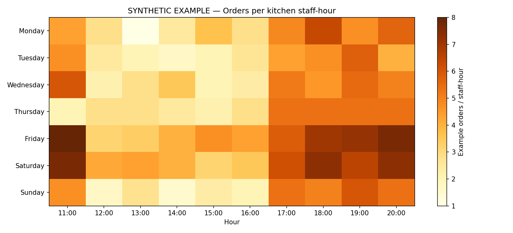

# Restaurant Staffing & Demand Analytics

**Privacy-safe analytics portfolio | Python · Pandas · NumPy · Matplotlib · Google Colab**

> **Data disclosure:** This repository contains a **fully synthetic, independently generated dataset** and a reproducible demonstration. It does not include employer information, confidential records, sales figures, attendance records, or organization-specific operational findings. The results shown here are illustrative, **not measured outcomes from any business**.



## Problem statement

Service businesses face variable customer demand across days and hours. A simple count of orders cannot by itself establish adequate staffing: shift overlap, record completeness, preparation effort, and operational duties all matter.

**Analytical question:** How can we combine time-stamped service demand and staff availability to identify intervals worth reviewing while keeping data-quality uncertainty explicit?

## Workflow

1. **Load and validate** time-stamped order records and shift coverage data.
2. **Normalize** observations to date-hour intervals; calculate fractional staff-hours from overlapping shifts.
3. **Combine** demand and staffing using an outer join, preserving staffed hours without orders and unmatched periods.
4. **Flag uncertain records** rather than imputing unknown staffing as zero.
5. **Analyze** demand-to-coverage ratios with eligible observation counts and appropriate caveats.
6. **Visualize** weekday-hour patterns using a heatmap and explain limitations.

The public implementation demonstrates these ideas on synthetic data. It is **not** a production-ready staffing optimizer and does not establish a threshold for an ideal number of workers.

## Run the demonstration

```bash
python -m pip install -r requirements.txt
python src/generate_sample_data.py
python src/analyze_demo.py
```

The first command installs requirements, the second regenerates deterministic synthetic inputs, and the third produces `outputs/demo_workload_heatmap.png`. You can also open `notebooks/01_public_demo.ipynb` in Google Colab.

## Repository structure

```text
restaurant-staffing-analytics/
├── README.md
├── requirements.txt
├── .gitignore
├── notebooks/01_public_demo.ipynb
├── src/generate_sample_data.py
├── src/analyze_demo.py
├── data/sample/synthetic_hourly.csv
└── docs/
    ├── images/demo_workload_heatmap.png
    ├── data_dictionary.md
    ├── methodology.md
    ├── power_bi_guide.md
    ├── publication_checklist.md
    ├── sprint_backlog.md
    ├── scrum_sprint.md
    └── github_profile_snippet.md
```

## Technology and status

| Component | Status |
|---|---|
| Synthetic reproducible Python example | Complete |
| Data-quality and workload definitions | Documented |
| Hourly visualization | Complete, synthetic only |
| Power BI | Possible future extension, **not yet delivered** |
| Predictive scheduling / labor savings | Not implemented or claimed |

## Analytical limitations

Orders are not equivalent to items prepared, and orders per recorded staff-hour is **not** an objective measure of understaffing, idle time, service delays, or profitability. Actual operating hours, customer wait times, staff capabilities, and precise break times would need to be verified in a real deployment.

## Suggested next steps

Build an independent Power BI example using synthetic tables; add simple unit tests for timestamps and incomplete shifts; compare demand distributions before considering any optimization method.
